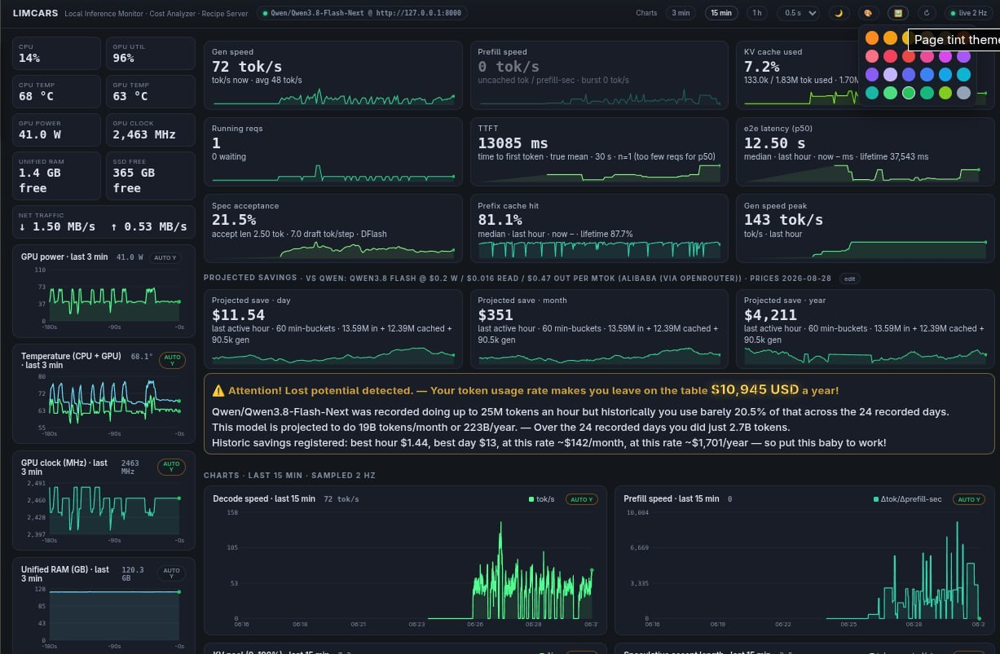
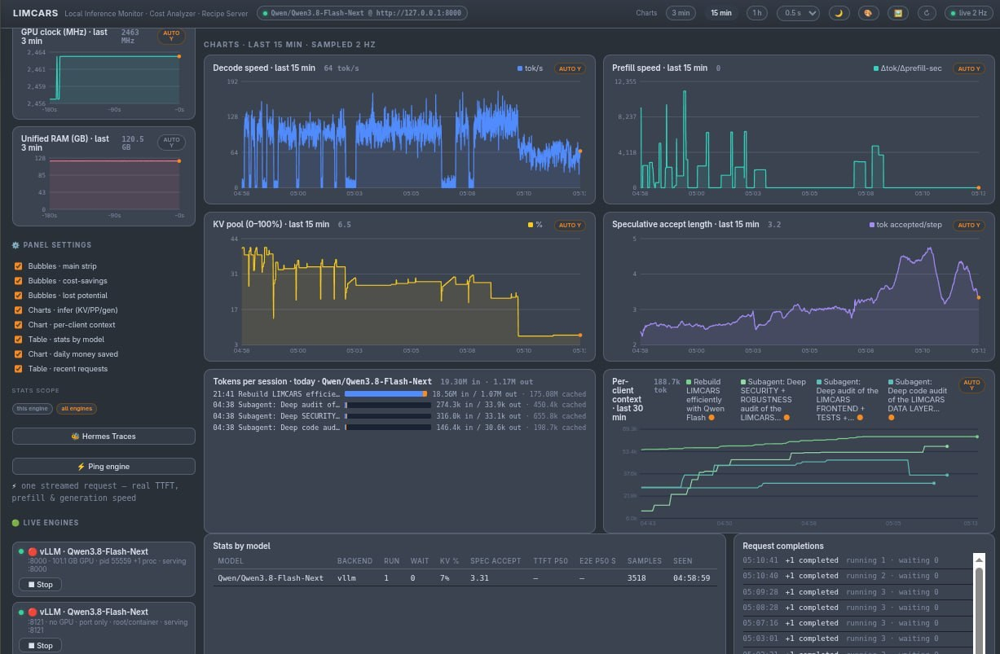
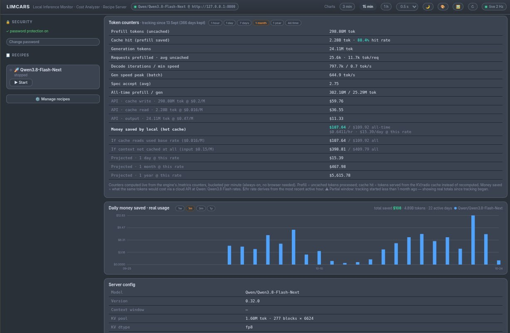
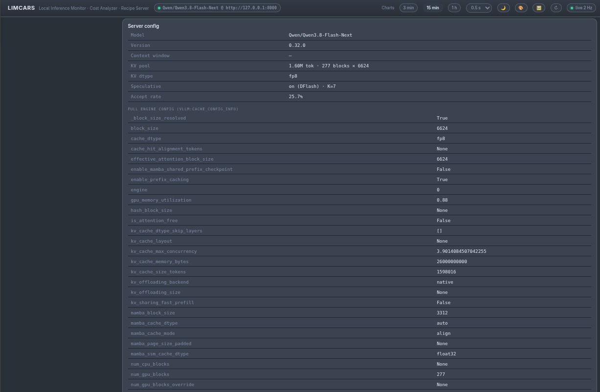

# 🚗 LIMCARS-Lean

> **LIMCARS-Lean** is an optimized, cleaned-up derivative of
> [LIMCARS](https://github.com/AgentSparko/LIMCARS) (imported at `7c9098e`).
> Same dashboard, same behavior, same honesty invariants — leaner backend hot
> paths, gzipped static assets and less dead code. See [CHANGELOG.md](CHANGELOG.md).
> Everything below describes LIMCARS and applies unchanged.

**L**ocal **I**nference **M**onitor · **C**ost **A**nalyzer · **R**ecipe **S**erver

Your **DGX Spark**, finally with a dashboard that tells the truth. Built and
tuned on a GB10 Spark, at home on any Linux inference rig: LIMCARS watches
your self-hosted LLM engines 2× per second and paints a live dashboard —
speeds, KV cache, thermals, hardware, token ledgers and real **money saved vs
cloud pricing** — plus a one-click recipe launcher for the engines themselves.

⚡ One Python process · 🧩 zero dependencies beyond `psutil` · 📡 no cloud, no telemetry, no accounts

> 🧪 **Honest status:** LIMCARS is developed and **tested on a single NVIDIA
> DGX Spark** (GB10, unified memory). It is designed to run anywhere Python 3
> does, but many features (the non-vLLM engine dialects, Hermes Traces, the
> recipe server under unusual setups) and any **hardware other than the Spark
> need further field testing** — if something misbehaves on your rig, open an
> issue, don't suffer in silence.

```bash
python3 -m app          # → http://localhost:8951
```




## ✨ What you get

### 📊 Live dashboard
- **Bubble strip** of everything that matters: decode & prefill tok/s, KV cache
  in tokens, running requests, TTFT, end-to-end latency, speculative
  acceptance, prefix-cache hits, peak gen speed — pushed live over SSE, no
  polling loops.
- **Hardware sidebar**: CPU/GPU utilization, temperatures, power, clocks,
  unified RAM, SSD and network ↓↑ — each with its own sparkline, smart axes
  and hover readouts.

> ⚠️ **Hardware scope**: the hardware tiles are designed for a **single
> DGX Spark** (GB10 unified memory, local `nvidia-smi`/hwmon). Everything
> *inference-related* — engines, token ledgers, money saved, probes, session
> stats — works perfectly across Spark clusters and multi-GPU rigs (point it
> at any number of engine URLs). The hardware sidebar, though, always
> reflects only the one machine LIMCARS itself runs on. The RAM tile is
> system memory (psutil) — on a Spark that is genuinely the pool your LLMs
> eat, on a normal PC it's plain system RAM. **VRAM is not shown**: a Spark
> has no discrete VRAM (`nvidia-smi` reports `N/A` by design), and a VRAM
> tile for discrete-GPU cards is not yet implemented — until then the
> engine's own KV-cache tiles are the best proxy for what the model actually
> reserved on the GPU.
- **Honest lights**: prefill/decode bubbles glow only while the engine is
  genuinely in that phase; idle latency holds its last real value instead of
  lying with a fat zero.
- 🎯 **Engine probe**: run a real streamed completion and see true TTFT,
  prefill and decode speed — measured, not estimated.

### 💰 Cost & tokens
- Per-model token ledger (write / cache-read / decode) in 1-minute buckets,
  kept for a year, reconciled to the engine's own counters to 0.00 %.
- Projected **$/day and $/year saved vs the equivalent cloud API**, computed
  from your last active hour at market prices.
- 🏦 **Daily money-saved chart** with week / month / 3-month / year switch —
  one color per model, hover for per-model cost and the full write/read/decode
  token split, totals across all models.



### 🍳 Recipe server
- Save each engine launch command as an emoji-named recipe and
  **Start / Stop from the sidebar** — per-recipe detached logs included.
- 🛰️ **Live engine detection** scans GPU compute apps, listening ports and
  process groups, so stray engines show up with their own Stop button.

### 🕵️ Hermes Traces (bonus)
If [Hermes Agent](https://hermes-agent.nousresearch.com) sessions live on your
box, LIMCARS doubles as a two-pane live browser of agent & subagent
transcripts — tailing logs, summaries, session stats, export.



## 🔌 Works with your engine

Engine kind is **auto-detected** — mix and match engines with zero
configuration. Missing metrics degrade to `–`, never to fake zeros.

| Engine | Support |
|---|---|
| 🟣 vLLM (v1) | full — counters, histograms, KV cache, spec decode |
| 🔶 SGLang | full — true live prefill rate |
| 🧊 exl3 | full — exact prefill/generate pairing |
| 🧮 TensorFold | full — dual metric families, spec decode |
| 🦙 llama.cpp | full counter set — running/deferred, prompt incl. cached, prefix-cache hit %, exact prefill & decode speed (tokens ÷ engine compute seconds), spec decode; no latency histograms upstream |
| 🗺️ [Atlas](https://github.com/Atlas-Inf/atlas) | partial — running requests, token counters, TTFT, spec-decode acceptance (per verify step); no queue / KV / cached-token metrics upstream |
| 🔁 [TandemLLM](https://github.com/0xBakeer/TandemLLM) | full — `qse_*` contract: counters, cached tokens + hit %, TTFT / ITL / e2e / queue / prefill histograms, spec decode, restart detection |

> **TandemLLM** is recognised from its official `qse_*` metric contract
> (`server/METRICS.md` upstream); the older `tandemllm:` / `qwen38:` names still
> work. KV-cache % stays `–` (the engine reports a unified memory pool, not a KV
> ratio). **llama.cpp** needs `llama-server --metrics`; it has no latency
> histograms, so TTFT / ITL / e2e bubbles stay `–`. Missing signals always
> degrade to `–`, never to fake numbers.

Prefill speed is measured **honestly**: prefix-cache hits are excluded and each
engine family is read through the most exact counter pairing it offers — so you
never see the phantom "100k tokens in half a second" spikes other dashboards
happily plot. 🧮



## 🚀 Quick start

```bash
git clone https://github.com/AgentSparko/LIMCARS-Lean.git
cd LIMCARS-Lean
python3 -m pytest tests/ -q     # optional sanity check (dialects, auth, security)
python3 -m app                  # open http://127.0.0.1:8951 🎉
```

**Requirements:** Python ≥ 3.10 and `pip install psutil` — that's it. Linux,
any NVIDIA/AMD/CPU box. No npm, no CDN, no database server.

Engines are discovered automatically from listening OpenAI-API ports; to pin
one explicitly, edit `data/config.json`:

```json
{ "engines": [ { "name": "MyModel", "url": "http://127.0.0.1:8000", "model": "org/model" } ] }
```

Handy environment variables:

| Variable | Default | Meaning |
|---|---|---|
| `LIMCARS_HOST` | `127.0.0.1` | bind address — `0.0.0.0` for LAN (requires auth; see Security) |
| `LIMCARS_PORT` | `8951` | dashboard port |
| `LIMCARS_DB` | `data/limcars.db` | history database path |
| `LIMCARS_TOKEN` | *(unset)* | bearer token for the HTTP API and the login page |
| `LIMCARS_ALLOW_EXEC` | `0` | flip to `1` to enable recipes / services / live-engine kill / probe |

## 🔁 Autorun — survive reboots, forget about it

### systemd (per-user, no sudo) — recommended

```bash
# one-shot installer — writes ~/.config/systemd/user/limcars.service with
# the right WorkingDirectory, enables + starts it, and turns on linger so
# the service survives logout:
bash scripts/install-user-systemd.sh

# any LIMCARS_* vars present at install time are baked into the unit:
LIMCARS_HOST=0.0.0.0 LIMCARS_TOKEN=my-shared-secret \
  bash scripts/install-user-systemd.sh
```

Watch it with `systemctl --user status limcars` or
`journalctl --user -u limcars -f`.

### systemd (system-wide)

For a shared host, use the templated system unit instead:

```bash
sudo cp scripts/limcars-next@.service /etc/systemd/system/
# edit WorkingDirectory / ExecStart to point at your clone (default is /opt/LIMCARS-Lean),
# then:
sudo systemctl daemon-reload
sudo systemctl enable --now limcars-next@<youruser>.service
```

Starts at boot ✅ restarts itself on failure ✅ plays nice under load (`Nice=5`) ✅

### cron @reboot (no systemd?)

```bash
crontab -e
# add one line:
@reboot cd /path/to/LIMCARS-Lean && /usr/bin/python3 -m app >> data/server.log 2>&1
```

## 🧬 Had another dashboard before? Bring your history

Don't start from zero — LIMCARS can absorb the measured usage your previous
dashboard recorded (token totals per minute), so the Lost-potential bubble 💡
and daily money-saved chart 📈 have real history from day one.

**Just tell your AI agent:**

> "I used <old dashboard name> on this machine before LIMCARS. Read
> `AGENTS.md` in the LIMCARS repo and migrate my history from it."

The agent gets a complete contract there: the exact
`counter_buckets` schema, the field-mapping traps (cached vs prompt is the
one everyone trips on), the no-double-count and measured-data-only rules,
and a verify-before-claiming loop. `scripts/import_legacy_history.py` ships
as a worked reference — an event-table-style source with per-request rows
(prefill + decode events, cached tokens tracked separately) — and it's also
how this repo's own history got populated. Every source dashboard
needs its own mapping pass — but that is precisely the kind of work a coding
agent does well. 🤖

## 🔐 Security — secure by default

LIMCARS now ships with a **closed** default surface. Everything that touches
the shell is behind an explicit opt-in, and anything exposed on the LAN
requires authentication.

- 🏠 **Binds to `127.0.0.1`** by default. A non-loopback bind
  (`LIMCARS_HOST=0.0.0.0` or similar) refuses to start unless at least one
  of a bearer token (`LIMCARS_TOKEN=…`) or an admin password is already
  configured — the dashboard refuses to open a LAN port into an unprotected
  install.
- 🛑 **Command execution is OFF.** Recipes (add/edit/delete/**start/stop**),
  services start/stop, live-engine kill, and the engine probe are ALL
  disabled on a fresh install. Flip the master switch when you want them:
  ```bash
  export LIMCARS_ALLOW_EXEC=1
  ```
  or set `"allow_exec": true` in `data/config.json`. The HTTP `/api/config`
  endpoint deliberately **cannot** toggle this — a compromised session
  can't turn the shell back on.
- 🔑 **Every route requires auth once auth is configured.** Pages redirect
  to `/login`; API routes return `401`. Three credentials satisfy the gate:
  * `LIMCARS_TOKEN` as a Bearer header (`X-Limcars-Token: …` or
    `Authorization: Bearer …`) — ideal for scripts;
  * an admin password set from the Security panel in the sidebar;
  * the browser login page at `/login` (HttpOnly, SameSite=Strict cookie —
    JS can't read it, cross-site POSTs can't ride it).
- 🧱 **Rate-limited login.** Shared with the recipe-edit gate: 3 wrong tries
  → 60 s freeze, 6 → 5 min, 9 → 30 min, 12 → 2 h. Passwords are stored as
  salted **scrypt** hashes and compared with `hmac.compare_digest`.
- 🗂️ **Hermes trace privacy.** `/subagent-watch/*` now uses the same session
  cookie as the main dashboard; the old `?pw=` query parameter is gone
  (it leaked into reverse-proxy logs / referrer headers / browser history).
- 📁 **File permissions.** `data/` is forced to `0o700` on every boot and
  `data/auth.json` is written `0o600`; a leaky umask on an older install
  cannot leave the password hash or the token ledger world-readable.
- 🛡️ **Origin / CSRF.** A cross-site POST whose `Origin` doesn't match the
  request Host is refused outright (`403`). `curl` / agent scripts send no
  Origin and are unaffected.
- ⚠️ **Running commands is still powerful.** When `allow_exec` is on, every
  action still prompts for the admin password, confirms destructive
  operations in the UI, and runs under the service's user — treat it with
  the trust you'd grant your own shell.

## 🕊️ Data & privacy

Everything stays on your box. `data/` (history, settings, recipes, password
hash, logs) is gitignored and never leaves the machine. LIMCARS makes no
outbound requests except to the inference engines you point it at. 🏠

## 🖧 Cluster nodes (agentless)

Watch the hardware of other machines (e.g. every DGX Spark in a cluster)
without installing anything on them: list them in `data/config.json` and pick
one in the sidebar's node selector.

```json
"nodes": [
  {"id": "spark-2", "ssh": "user@spark-2.local"},
  {"id": "spark-3", "ssh": "user@10.0.0.13", "ssh_opts": ["-p", "2222"]}
]
```

Requirements: `sshd` on the node and key-based (passwordless) login from the
LIMCARS box — check with `ssh -o BatchMode=yes user@host true`. LIMCARS keeps
one persistent SSH connection per node and once a second pipes a short
`sh` script that reads `/proc`, `df`, hwmon and `nvidia-smi`. An unreachable
node shows its SSH error in the sidebar and is retried every ~5 s.

## 🤝 Contributing

Fork → branch → `python3 -m pytest tests/ -q` before opening a PR — dialects,
auth lockout and counter conservation all have tests. Bug reports with an
engine name + `/metrics` snippet are extra welcome. 🙏

## 📜 License

MIT — see [LICENSE](LICENSE). Derived from LIMCARS by AgentSparko; the original license is kept as-is.
